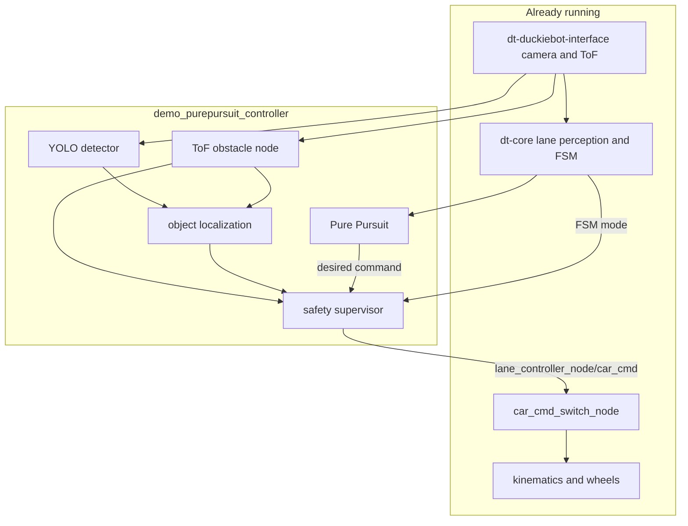

# Quackcomm YOLO Pure Pursuit

Lane following for Duckiebot `myrobot2` (DB21J). The custom container runs beside the existing Duckietown stack. It does not start another `roscore`, another camera driver, or a copy of `dt-core`.

`dt-core` still owns the camera correction, line detector, ground projection, and lane filter. This demo reads those topics. Pure Pursuit proposes a command. A safety supervisor is the only node in this demo that publishes a chassis command, and it publishes that command to the lane-controller input of `car_cmd_switch_node`. Wheel commands and the emergency stop stay with the existing driver containers.

The image name is `anandagarwal2004/quackcomm-yolo:v1-arm64v8`.

## Architecture



DTS 6.2.27, ente profile, starts container `demo_<demo_name>` on the robot Docker socket. With no `--package_name`, the container command is `dt-launcher-purepursuit_controller`. With `--package_name purepursuit`, the command is `roslaunch purepursuit purepursuit_controller.launch`. Both paths are in this repository. The launcher does not set `ROS_MASTER_URI`; DTS sets it to `http://<robot-ip>:11311`.

## What was already in this repository

The launchable lane follower was `packages/duckiebot_pure_pursuit`. Its launcher ran `pure_pursuit_node.py`, which finds the lane in the camera image and publishes `car_cmd_switch_node/cmd_lane_following`. There is no `packages/purepursuit` history and no red-HSV obstacle detector in this tree. That older node is still in the tree and is no longer launched.

The new package is `packages/purepursuit`. It keeps the same curvature law:

```text
curvature = 2 * lateral / (forward^2 + lateral^2)
omega = clip(speed * curvature)
```

Positive lateral, to the robot's left, produces a left turn. Positive `omega` is counter-clockwise.

## Algorithms

**YOLO.** The worker keeps one compressed frame. A new frame replaces it, so inference never drains a backlog. The vendored graph is YOLOv5n COCO, input 640, FP16 ONNX, documented in `packages/purepursuit/models/SOURCE.txt`. Decoding reads the `(25200, 85)` rows as `cx, cy, w, h, objectness, class scores`, applies class-agnostic NMS, and maps the letterbox back to the camera image. A track is confirmed after two overlapping hits, or on the first hit when confidence is at least 0.75. ToF stops do not wait for that confirmation.

**ToF.** The node subscribes to `sensor_msgs/Range` on the existing front-center driver. Readings are median-filtered. `+inf` is treated as no return. A value below the sensor minimum is treated as close. A stale sample is never reported as clear.

**Localization.** The bottom-centre of a box is projected to the ground plane `z = 0`. Robot axes are x forward and y left. The default camera height is 0.10 m and the default pitch is 15 degrees down. Those numbers are an uncalibrated DB21 approximation. `camera_info` replaces the focal length and principal point when it arrives. A nine-value homography in `localization.yaml` replaces the pinhole model. A ray that misses the ground, or lands behind the robot, is an invalid projection. An invalid box that still overlaps the middle of the image is treated as an uncertain corridor object. ToF distance is copied onto an object only when that object is in the forward beam and the ToF reading is closer than the projection.

**Lane detection** (`lane_detector_node`, `pp_core/lane_vision.py`). Yellow and white HSV masks are projected to the ground with the robot's calibration. Each line is fit as a circle arc (RANSAC, then Gauss-Newton on the geometric distance; straight unless a curve fits clearly better). Duckietown lines are straight segments and arcs, so this holds in a right turn (lane-centre radius ~0.18 m), which the earlier quadratic fit rejected. The two lines of a lane are concentric: each gives the centre by moving it half a lane width along its normal, and a white line that is not parallel to the yellow along their whole overlap is dropped. Output: `d`, `phi`, `curvature` in the dt-core LanePose convention.

**Pure Pursuit** (`purepursuit_controller_node`, `pp_core/vision_pursuit.py`). A Kalman tracker carries `(d, phi, curvature)` forward over the camera delay with the Frenet motion model. The command is the lane's curvature fed forward plus Pure Pursuit's small-angle feedback, `kappa = kappa_lane cos(phi) / (1 - kappa_lane d) - 2 d / L^2 - 2 sin(phi) / L`, with a speed-dependent lookahead `L` that shrinks in tight turns. On a straight this is Pure Pursuit; in a turn it keeps full correction. dt-core's `lane_pose` and ground segments remain fallbacks while they publish (positive `d`: robot left of centre; `lane_pose_d_sign` / `lane_pose_phi_sign` flip that).

**Lane loss** (`pp_core/recovery.py`). Without a lane estimate the controller coasts on the tracker's prediction (0.6 s), or inside a turn keeps turning until the quarter turn is done (at most 3 s), then rotates in place toward where the lane was last seen, sweeping wider each way, and stops after 6 s. `ControllerStatus.status` shows `tracking`, `coast`, `turn_memory`, `search`, `lost` or `waiting`. Settings are in `config/controller.yaml`.

**Recording.** `./demo.sh record [seconds]` records camera, lane estimates, controller and safety state to `~/quackcomm-bags/` and prints a timeline of what the robot saw and decided. The debug image (`./demo.sh view`) draws the lane centre green when it is used and red when it was rejected, with the reason.

**Safety.** The supervisor reads the latest desired command, detections, ToF status, and FSM mode at 20 Hz.

| YOLO | ToF | Result |
|---|---|---|
| No corridor object | Clear | Desired command, scaled down if YOLO itself is stale |
| Corridor object | Inside stop distance | Stop. ToF wins |
| Corridor object | Farther than the brake distance | Follow |
| Corridor object inside the brake region | Not inside the stop distance | Slow across that region |
| No detection | Inside stop distance | Stop |
| Object outside the corridor | Clear | Follow |
| Corridor object | Invalid or stale | Stop |
| Both unavailable | Both unavailable | Fail-safe stop |

`allow_motion` defaults to true (start with `ALLOW_MOTION=false` for bench testing), and the first two seconds after start are still zero. A stop caused by an obstacle is held until the path has been clear for `clear_hold_s`. The supervisor also latches `false` onto `lane_controller_node/switch` and `obstacle_avoidance_node/switch` so those nodes do not publish a second command. It never publishes `wheels_driver_node/wheels_cmd` or `wheels_driver_node/emergency_stop`.

Motion is authorized only while `fsm_node/mode` is `LANE_FOLLOWING`.

## Topics

Replace `myrobot2` with `VEHICLE_NAME` if you use another robot.

```bash
rostopic list
rostopic type /myrobot2/purepursuit/detection_array
rostopic echo /myrobot2/purepursuit/safety_state
rostopic hz /myrobot2/purepursuit/obstacle_distance
rostopic echo /myrobot2/purepursuit/latency
rqt_image_view /myrobot2/purepursuit/yolo_debug_image/compressed
```

| Topic | Type | Meaning |
|---|---|---|
| `/myrobot2/purepursuit/detections_raw` | `purepursuit/DetectionArray` | YOLO tracks before projection |
| `/myrobot2/purepursuit/detection_array` | `purepursuit/DetectionArray` | Class, box, confidence, distance, corridor flag |
| `/myrobot2/purepursuit/yolo_debug_image/compressed` | `sensor_msgs/CompressedImage` | Boxes, labels, corridor, lane points |
| `/myrobot2/purepursuit/obstacle_distance` | `purepursuit/ObstacleStatus` | Filtered ToF |
| `/myrobot2/purepursuit/desired_cmd` | `duckietown_msgs/Twist2DStamped` | Pure Pursuit proposal |
| `/myrobot2/purepursuit/controller_status` | `purepursuit/ControllerStatus` | Lookahead and curvature |
| `/myrobot2/purepursuit/safety_state` | `purepursuit/SafetyState` | Authorized command and reason |
| `/myrobot2/purepursuit/latency` | `diagnostic_msgs/DiagnosticArray` | Decode, inference, ages, fusion |
| `/myrobot2/lane_controller_node/car_cmd` | `duckietown_msgs/Twist2DStamped` | The one authorized command |

`distance_m` is `-1` when the distance is unknown.

The annotated image uses the anti-Instagram topic by default, because that is the corrected camera stream already running in `dt-core`. Set `~image_topic` on both the detector and the localization node to `/myrobot2/camera_node/image/compressed` if you want the raw frames instead.

Before driving, confirm the live types:

```bash
VEHICLE_NAME=myrobot2 rosrun purepursuit validate_topics.py myrobot2
```

The expected types were taken from the ente message definitions and from `sensor_msgs`. They have not been checked against `myrobot2` from this workstation.

## Build

Build on the Jetson, or with an arm64 builder. An image built on an x86 laptop without `--platform linux/arm64` will not run on the Nano. After the build, check the real architecture. The tag `arm64v8` is only a name.

```bash
docker build \
  --build-arg ARCH=arm64v8 \
  --build-arg DISTRO=ente \
  -t anandagarwal2004/quackcomm-yolo:v1-arm64v8 \
  .

docker image inspect anandagarwal2004/quackcomm-yolo:v1-arm64v8 --format '{{.Architecture}} {{.Os}}'
```

The architecture field must be `arm64`. The base image is `duckietown/dt-ros-commons:ente-arm64v8`, not `dt-core` and not `charared/charan_ros_core`.

The ONNX file is already in the build context. The container does not fetch it at runtime. `onnxruntime==1.16.3` is installed when a matching wheel exists. That wheel exists for CPython 3.8 and 3.10 on aarch64. It does not exist for Python 3.6.

Transfer, if the image was not built on the robot:

```bash
docker save anandagarwal2004/quackcomm-yolo:v1-arm64v8 | ssh duckie@myrobot2.local docker load
```

Or push and let the robot pull:

```bash
docker push anandagarwal2004/quackcomm-yolo:v1-arm64v8
```

## Run

To run in the Duckiematrix simulator on a virtual Duckiebot instead of `myrobot2`, see [SIMULATION.md](SIMULATION.md).

Leave `dt-duckiebot-interface`, `dt-car-interface`, and `dt-core` running. The preferred command matches the installed DTS 6.2.27 ente launcher:

```bash
dts duckiebot demo \
  --demo_name purepursuit_controller \
  --duckiebot_name myrobot2 \
  --image anandagarwal2004/quackcomm-yolo:v1-arm64v8
```

The legacy form also works, because the launch file accepts `veh`, `robot_type`, and `robot_configuration`:

```bash
dts duckiebot demo \
  --demo_name purepursuit_controller \
  --duckiebot_name myrobot2 \
  --package_name purepursuit \
  --image anandagarwal2004/quackcomm-yolo:v1-arm64v8
```

`allow_motion` is true by default, so the robot drives as soon as the FSM is in `LANE_FOLLOWING` (after a two-second startup hold). Inspect the debug image and `safety_state` first, then put the FSM in `LANE_FOLLOWING` with the existing keyboard controller (A starts, S stops). To disable or re-enable motion on a running robot:

```bash
rosparam set /myrobot2/safety_supervisor_node/allow_motion true
rostopic echo /myrobot2/fsm_node/mode
rostopic info /myrobot2/lane_controller_node/car_cmd
```

`rostopic info` must show this demo as the only publisher of `lane_controller_node/car_cmd` before the robot is allowed to drive. If the stock lane controller is still publishing, do not enable motion.

Logs are the Portainer log view of container `demo_purepursuit_controller`, or:

```bash
docker -H myrobot2.local logs -f demo_purepursuit_controller
```

Latency on the robot, while it is stationary:

```bash
VEHICLE_NAME=myrobot2 BENCHMARK_SECONDS=10 rosrun purepursuit benchmark.py
```

There are no measured Nano timings in this repository. The benchmark script prints `not observed` when a topic is silent.

## Replacing the previous demo

DTS removes a running container named `demo_purepursuit_controller` before it starts the new one. To stop only that container:

```bash
docker -H myrobot2.local stop demo_purepursuit_controller
```

Do not stop or remove `dt-core`, `dt-duckiebot-interface`, `dt-car-interface`, or the hardware drivers.

## Tests

On a workstation, without ROS:

```bash
PYTHONPATH=packages/purepursuit/src python3 -m unittest discover -s packages/purepursuit/test -v
```

The tests cover the safety table, ToF sentinels, a single-frame false detection, corridor membership, pursuit sign, and the rule that the authorized command is not the wheel topic. They do not drive a robot.

## Limits

- This workstation is Ubuntu 22.04, x86_64, with ROS Humble installed. It is not the Jetson. JetPack, CUDA, TensorRT, and the robot's OpenCV were not inspected. No image was built or loaded onto `myrobot2`, and no driving test was run.
- The ente `dt-ros-commons` Dockerfile declares ROS Noetic. The Nano host is Ubuntu 18.04. If the containers already running on the robot are Melodic, or Python 3.6, confirm that with `validate_topics.py` and with `python3 --version` inside a running Duckietown container before trusting the image.
- `dts duckiebot demo` starts the container with an 800 MB RAM limit and 2800 MB of memory plus swap. A 640-pixel YOLO network plus the rest of the pipeline can exceed that on a 4 GB Nano, because GPU memory is unified. If the container is killed, this limit is the first place to look. The DTS command hardcodes it.
- The COCO model will not detect duckies or Duckiebots. Person and vehicle classes are the ones it can use. Custom training is in `packages/purepursuit/models/README.md`.
- The detector executes ONNX on CPU. `scripts/build_tensorrt_engine.py` can create an engine on the Nano. The running node does not execute that engine.
- Ground distances from the camera are only as good as the extrinsic parameters. Close stopping uses the ToF beam and does not require the projection.
- The previous image-space follower in `packages/duckiebot_pure_pursuit` is not started. Its command topic is not the authorized output.
